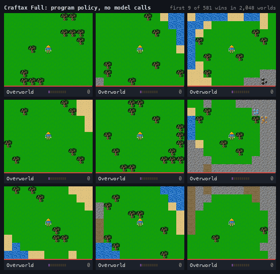

# Continuation-Guided LLM Evolution of Program Policies and Goal Compilers in Craftax

<p align="center">
  
</p>
<p align="center"><sub>The first 9 of the 581 worlds (out of 2,048) in which the optimized policy defeats the Necromancer. Each tile shows only what the program observes; playback is fast through floors 0–7 and slows down for the final fight. Below each tile: health (red), floors reached and step count. <a href="assets/victories.mp4">Full-resolution video</a>.</sub></p>

[Craftax](https://github.com/MichaelTMatthews/Craftax) is a procedurally generated survival game: with only a small view of the map and 100,000 actions, the agent has to go down eight floors and beat the Necromancer. Our policy is a C program that coding agents (Claude Code and Codex) wrote and refined from simulator feedback, and it makes no model calls while playing. Scored on whole episodes, it reached the last floor in only 0.29% of worlds. With finer feedback, which ends up scoring each edit by how much it raises the chance of reaching the last floor from saved game states, it gets there in 50.49% of 2,048 test worlds, and a boss-focused extension wins 28.37%.

We then split the policy into a fixed machine `I` and a rule program `p0`, and had coding agents optimize a goal compiler that writes new rule programs for new tasks. Trained on short tasks, the frozen compilers complete 71.30% of unseen tasks of up to 8 stages, against 36.20% for the base policy with resource guards. See the paper for details.

| Directory | Contents | Paper |
|---|---|---|
| `engine/` | The Craftax Full C engine (`craftax_full.c`, from [craftax.cu](https://github.com/Infatoshi/craftax.cu), unmodified) | Policies and Goals |
| `policies/optimized/` | The optimized program policy (Final checkpoint): floor-8 arrival in 50.49% of common worlds | Policy Development, Fig. 2 |
| `policies/optimized_extension/` | Its boss-victory extension (28.37% Necromancer victories); this is P*, the policy that is factored | Boss-Victory Extension appendix |
| `policies/checkpoints/`, `policies/controls/` | The other 24 lineage checkpoints and the two matched-budget controls | Fig. 2, lineage appendix |
| `policies/results/` | Per-world rows of the common cohort and the result records behind the tables | Table 2, lineage and campaign tables |
| `harness/` | Stage-1 feedback-cascade tools (regimes A–E): per-floor funnels, savestate banks and branching, goal handoffs, belief audits | Feedback Cascade, Table 1 |
| `factorization/` | Target t (C++ translation of P*), machine `I`, rule program `p0` (TR language), the TR compiler, and the parity check | Policy Factorization; Factorization and Execution |
| `compiler/` | Goal compilers: Encode/Link, the 5 shared and 12 per-task selected emitters with their search archives, tasks, monitor, held-out rows and analysis | Goal Compilation; Goal Generalization |

Each directory has its own README with details.

## Requirements

- Python 3 (standard library only for building and running).
- clang and clang++ (C11 and C++23).
- NumPy and Matplotlib, only for `compiler/report.py`.
- zlib, only for the harness.

Tested only on macOS (arm64) with Apple clang 21.

## Reproducing the main results

Run from the repository root. Generated files go to `build/` directories.

**1. Optimized policy (common cohort: 2,048 worlds, seed 81,000,000, 100,000-action horizon).** `--check` requires every per-world row to equal the archived one.

```sh
# Final: 1,034/2,048 floor-8 arrivals (50.49%), 183 victories, mean return 166.98
python policies/evaluate.py policies/optimized --check policies/results/common_cohort/optimized.csv.gz
# Boss-victory extension: 581/2,048 victories (28.37%), the same 1,034 arrivals
python policies/evaluate.py policies/optimized_extension --check policies/results/common_cohort/optimized_extension.csv.gz
# Lineage table and paired contrasts from the archived rows, no simulation
python policies/summarize.py
```

A full 2,048-world run takes about 15 minutes with 5 workers (`--workers`).

**2. Factorization parity.** P*, t, I(p0) (interpreted) and mix(I, p0) (specialized) must choose the same action and skill at every step, with scratch memory poisoned: 64 dev worlds (3,209,631 decisions) and 256 held-out worlds (12,354,934 decisions).

```sh
python factorization/parity.py check --jobs 5
```

**3. Goal compilers.**

```sh
# Table 3, Figure 3 and every contrast from the retained held-out rows
# (Shared 71.30%, Guards 36.20%, Shared - Guards +35.10 [+25.78, +45.08])
python compiler/report.py
# Compile the worked example of the appendix with shared emitter 5, then inspect build/example
python compiler/compiler.py compiler/goals/test/t_d48da6015806f6ea.json --arm synthesized \
    --controller compiler/synthesis/run_5/selected.py --output compiler/build/example
# Execution checks: interpreted vs specialized parity, negative control, emitter audits; unit tests
python compiler/validate.py parity
python compiler/validate.py controls
python compiler/validate.py audit
python -m unittest discover -s compiler/tests -v
# Re-run the held-out evaluation (12,672 episodes; see compiler/README.md for subsets)
python compiler/evaluate_study.py test --check
```

To run a new compiler search, give any coding agent the prompts in `compiler/prompts/`; `compiler/README.md` describes the tools it can use.

**4. Feedback-cascade harness (optional).** `harness/README.md` has a smoke test covering per-floor comparisons, savestate capture and resume, goal handoffs and the belief audit, for example:

```sh
cd harness
python bank.py capture --policy-dir ../policies/checkpoints/18_r16 --name smoke \
    --seed 81000000 --episodes 16 --trigger arrive:3 --log-goals
```

## License

Apache License 2.0 (see `LICENSE`). The engine is from craftax.cu, a reimplementation of [Craftax](https://github.com/MichaelTMatthews/Craftax) (MIT); see `NOTICE`.
